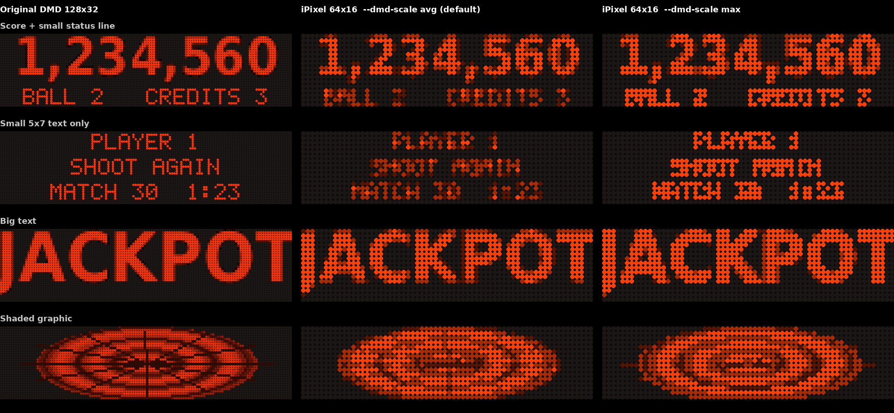

# iPixel Bridge for Visual Pinball

Use a cheap **iPixel Color 64x16 Bluetooth LED display** as an extra mini-DMD in your virtual pinball cabinet.

`ipixel_bridge.py` keeps a Bluetooth LE connection to the display open and accepts input from two sources:

- **DMD mirror**: shows the DMD of any VPinMAME / FlexDMD / Future Pinball table, streamed by [freezy's DMD Extensions](https://github.com/freezy/dmd-extensions).
- **Table commands**: your own table scripts can send texts, scores and pictures with simple HTTP requests (`JACKPOT`, `EXTRA BALL`, the current score …).

```
VPinMAME / FlexDMD ──► DmdDevice.dll (dmdext) ──► your normal DMD (unchanged)
                                             └──► network stream (WebSocket) ─┐
                                                                              ├──► ipixel_bridge.py ──BLE──► iPixel 64x16
VPX table script ──── HTTP GET (127.0.0.1:8765) ──────────────────────────────┘
```



## What to expect

A standard DMD is 128x32 and this display is 64x16, so every 2x2 block of DMD dots becomes one LED.

- **Big fonts** (scores, JACKPOT, mode titles) are clearly readable.
- **Small fonts** (status lines, credits) get blurry. You can often still read them on the real display, but they're not sharp.
- **Animations** keep their shape, but the frame rate is limited by Bluetooth: a few frames per second during busy animations, close to instant for static screens.

It's a cheap toy, not a replacement for a real DMD, but it adds a lot of fun for very little money.

## Features

- DMD mirror for any table that goes through dmdext: 2-bit and 4-bit grey, coloured frames (colorizations), RGB24, and 128x32, 192x64 and 256x64 DMDs
- Built-in WebSocket server for dmdext's `[networkstream]` output (no extra packages needed)
- Table commands always win over the mirror; the mirror waits a few seconds after the last command
- Own proportional 5x7 pixel font: one big line or two small lines, scrolling only when really needed
- Scores with thousands separators that never scroll (tested up to 98,765,432,100)
- Pictures, GIF upload into the display's memory slots, brightness and power control
- Live drawing in DIY mode (like the phone app), sending only the pixels that changed
- Keepalive, so the display doesn't fall back to its own stored program
- Automatic reconnect after Bluetooth errors
- `dmdpreview` command to check how a DMD picture will look, without the display

## Requirements

- An **iPixel Color 64x16** LED display (Bluetooth LE, advertises as `LED_BLE_…`)
- Python 3.8 or newer
- Windows (the cabinet) or macOS (handy for testing); Linux should work too
- For the DMD mirror: [DMD Extensions](https://github.com/freezy/dmd-extensions/releases) version 1.8.2 or newer

```
pip3 install bleak pillow
```

## Quick start

1. **Find the display:**
   ```
   python3 ipixel_bridge.py scan
   ```
   On Windows the address is a MAC address (`F4:D6:8A:…`). On macOS it's a UUID. They differ per computer.

2. **Test it:**
   ```
   python3 ipixel_bridge.py --addr <ADDR> test
   python3 ipixel_bridge.py --addr <ADDR> text "WUBBA LUBBA" --color 00ff60
   ```

3. **Run the bridge for your cabinet**, with the DMD mirror enabled:
   ```
   python3 ipixel_bridge.py --addr <ADDR> serve --dmd
   ```

## DMD mirror setup

### 1. Enable the network stream in DmdDevice.ini

Add this block to the `DmdDevice.ini` that VPinMAME uses:

```ini
[networkstream]
enabled = true
url = ws://127.0.0.1:8766/dmd
retry = true
retry-interval = 5
```

Your other outputs (virtual DMD, PIN2DMD, PinUP …) keep working. dmdext just sends the same frames to one more place.

To turn the mirror off for a single table, use a per-game section with the ROM name:

```ini
[simp]
networkstream enabled = false
```

### 2. Make sure VPinMAME really uses dmdext

- In VPinMAME's `Setup64.exe` (or `Setup.exe`), tick **Use External DMD (dll)**, either in the defaults or per game.
- 64-bit VPX loads `VPinMAME64.dll`, which needs **`DmdDevice64.dll`** in the same folder.
- If `DMDDEVICE_CONFIG` is set (`echo %DMDDEVICE_CONFIG%`), dmdext reads the ini at that path.
- **Several VPX / VPinMAME folders?** VPinMAME may be loading an older folder than you think. Update the DLLs in every VPinMAME folder.

### 3. Future Pinball

Future Pinball goes through `dmdext.exe` instead of the DLL:

```
dmdext mirror --source=futurepinball --use-ini
```

Add the same `[networkstream]` block to the ini dmdext uses there.

### 4. UltraDMD tables

The original UltraDMD draws its own window and doesn't go through dmdext. Tables using **FlexDMD**, the UltraDMD replacement, do go through dmdext and work with the mirror.

### 5. Check it

Start the bridge, then launch a ROM table. The console should show:

```
DMD mirror: waiting for dmdext on ws://127.0.0.1:8766/dmd
DMD: dmdext connected
DMD: game fg_1200
DMD fg_1200: 24.0 frames/s from dmdext, 4.8 frames/s on the display
```

You can also test the connection without VPX:

```
dmdext test -d network --url ws://127.0.0.1:8766/dmd
```

### Preview without the display

```
python3 ipixel_bridge.py dmdpreview screenshot.png
```

This takes a DMD picture (128x32, or a screenshot of a DMD window, PNG or GIF) and writes `screenshot_ipixel.png`: the DMD on top, the 64x16 LEDs below. Add `--dmd-scale max` to compare the bolder mode.

## Table commands (HTTP API)

All commands are plain `GET` requests to `http://127.0.0.1:8765/`. The answer comes back immediately and the drawing happens in the background. A new command cancels the running one, so the newest command always wins.

| Path | What it does |
|---|---|
| `/text?msg=JACKPOT&color=ff2020` | One big line, or two small lines with `\|` (e.g. `msg=EXTRA\|BALL`). Optional: `bg=rrggbb`, `size=big\|small`, `repeat=n` |
| `/score?v=12345678&color=ffd000` | Big digits with commas; never scrolls |
| `/image?file=C:\path\pic.png` | Show a picture, scaled to 64x16 |
| `/gif?file=C:\path\anim.gif&slot=1` | Upload a GIF into a memory slot (the display plays it on its own) |
| `/slot?n=1` | Show stored slot 1–9 |
| `/brightness?v=1..100` | Display brightness |
| `/power?on=1\|0` | Display on or off |
| `/clear` | Clear the display |
| `/dmd?on=1\|0` | DMD mirror on or off (only with `serve --dmd`) |
| `/status` | Connection and mirror status |

### Example: VBScript in a VPX table

```vbscript
Const IPX_URL = "http://127.0.0.1:8765/"

Sub IpxSend(path)
    On Error Resume Next
    Dim http : Set http = CreateObject("MSXML2.ServerXMLHTTP.6.0")
    http.setTimeouts 300, 300, 300, 300
    http.open "GET", IPX_URL & path, True     ' True = asynchronous, never blocks the table
    http.send
End Sub

' Examples
IpxSend "text?msg=JACKPOT&color=ff2020"
IpxSend "text?msg=EXTRA|BALL&color=ff8000"
IpxSend "score?v=" & Score(CurrentPlayer)
```

Use `+` or `%20` for spaces in texts (`msg=GAME+OVER`). If a table also has a DMD going through dmdext, its commands take priority and the mirror resumes `--dmd-pause` seconds after the last one.

## Command line options

| Option | Default | Meaning |
|---|---|---|
| `--addr` | | Display address (from `scan`) |
| `--port` | `8765` | HTTP port for table commands |
| `--host` | `127.0.0.1` | Use `0.0.0.0` to test from another computer |
| `--fps` | `5` | Scroll speed for texts |
| `--bright` | `100` | Picture brightness 1–100 |
| `--mode` | `diy` | `diy` = live pixels (only changes are sent), `frame` = one raw frame |
| `--chunk` | `0` | BLE write size, 0 = from the MTU |
| `--gap` | `0.003` | Pause between BLE writes (seconds) |
| `--fast` | off | Write without response: faster, but this display loses packets |
| `--dmd` | off | Enable the DMD mirror (with `serve`) |
| `--dmd-port` | `8766` | WebSocket port for dmdext |
| `--dmd-fps` | `10` | Maximum DMD frames per second sent to the display |
| `--dmd-scale` | `avg` | `avg` = softer, `max` = bolder (thin lines stay bright) |
| `--dmd-gain` | `1.5` / `1.0` | Brighten thin lines (default depends on the scale mode) |
| `--dmd-levels` | `4` | Brightness steps including black; fewer = fewer BLE packets |
| `--dmd-color` | from dmdext | Force the DMD colour, e.g. `ff7000` (cheap LEDs often show orange as red) |
| `--dmd-pause` | `4` | Seconds the mirror waits after a table command |

Other commands: `info`, `bench` (measures the frame rate), `erase` (deletes all stored programs on the display), `reset` (back to the display's default mode), `raw <hex>` (send a raw packet), `dmdpreview <file>`.

## Running at startup (Windows)

Create a `start_ipixel.bat` and put a shortcut to it in `shell:startup`:

```bat
@echo off
cd /d C:\path\to\ipixel_bridge
python ipixel_bridge.py --addr F4:D6:8A:XX:XX:XX serve --dmd
```

## How it works

**Bluetooth protocol.** The write characteristic is `0000fa02-…` and the notify characteristic is `0000fa03-…`. Packets are `length (2 bytes, LE) + command (2 bytes, LE) + data`. In DIY mode the bridge enters live drawing once, then sends coloured pixel lists (up to 120 pixels per packet), grouped by colour, for only the pixels that changed.

**DMD mirror.** dmdext's network stream sends binary WebSocket messages (`name\0data`, little endian), as defined in `LibDmd/Output/Network/WebsocketSerializer.cs`. The bridge decodes the bit planes and shrinks the frame to 64x16 with a box filter. It then reduces it to a few brightness steps and hues, so each frame needs only a few BLE packets. It always draws the newest frame and skips the ones in between.

**Priority.** Table commands, the DMD mirror and the keepalive share one BLE link. Locks make sure packets and pictures never get mixed up.

## Troubleshooting

| Problem | Try this |
|---|---|
| `scan` finds nothing | Close the phone app (the display accepts only one connection) and move closer |
| Garbage pixels | Don't use `--fast`; raise `--gap` slightly |
| Display shows its own program after a while | Normal when idle; the keepalive brings it back while the bridge runs |
| "waiting for dmdext" never changes | See [DMD mirror setup](#dmd-mirror-setup): external DMD option, `DmdDevice64.dll`, the right VPinMAME folder |
| `DmdDevice.log` not where you expect | The log path is relative to the program that loaded the DLL (often the VPX folder). Set a full path in `DmdDevice.log.config` |
| DMD animations are slow | Try `--dmd-levels 3` or `--mode frame` and compare the frames/s line in the console |
| Wrong colour | `--dmd-color ff7000` and adjust by eye |

## Credits

- BLE protocol: [sdolphin-JP/ipixel-ctrl](https://github.com/sdolphin-JP/ipixel-ctrl) and [yyewolf/go-ipxl](https://github.com/yyewolf/go-ipxl)
- DMD streaming: [freezy/dmd-extensions](https://github.com/freezy/dmd-extensions)
- [Visual Pinball X](https://github.com/vpinball/vpinball), [VPinMAME](https://github.com/vpinball/pinmame) and [FlexDMD](https://github.com/vbousquet/flexdmd)

This is a hobby project and is not affiliated with the makers of the iPixel display or any of the projects above.

## License

Add your license here (for example MIT).
